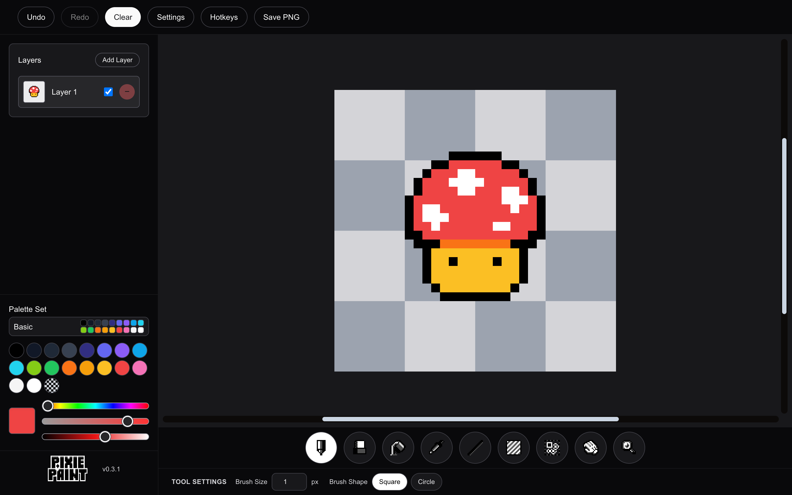
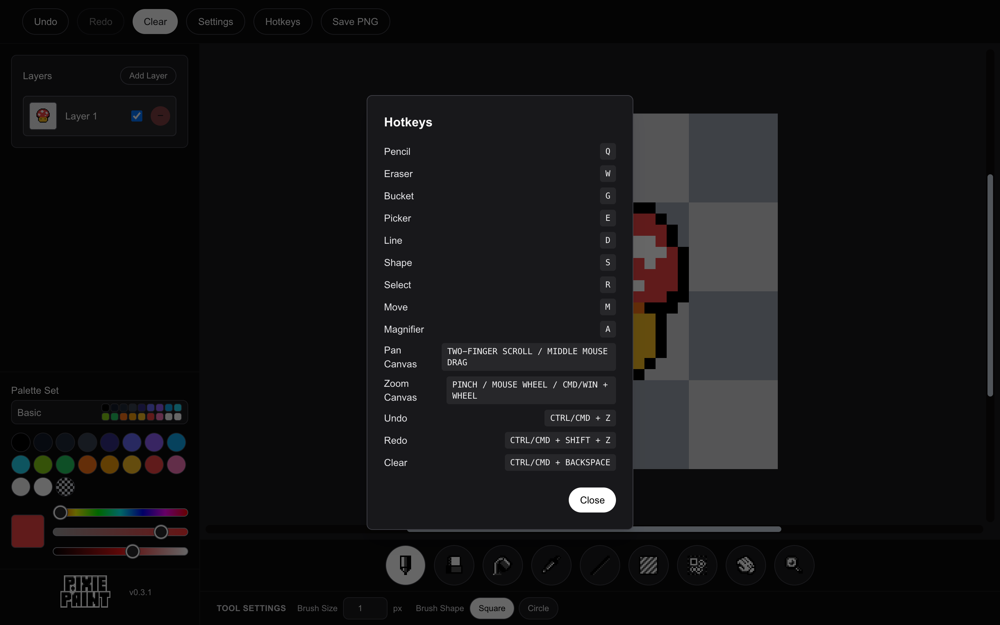
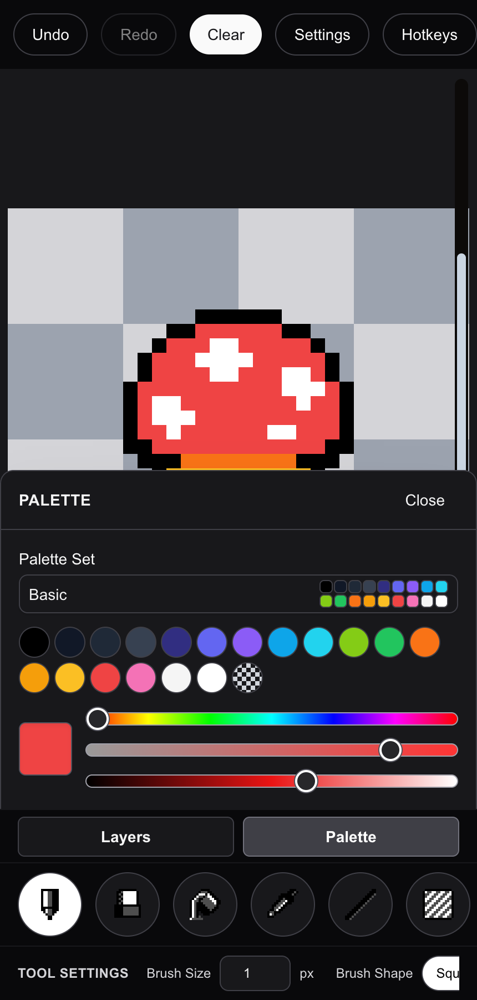

<p align="center">
  
</p>

# Pixie Paint

Pixie Paint is a free, browser-based pixel art editor. Open it, pick a tool, draw on a layered grid, and save your sprite as a PNG. Nothing is uploaded: the artwork lives in your browser until you export it.

**Try it now: [https://pixiepaint.hectormagana.art](https://pixiepaint.hectormagana.art)**



## Features

- **Nine tools:** Pencil, Eraser, Bucket fill, Color picker, Line, Shape, Rectangular select, Move, and Magnifier. Every tool has a single-key hotkey.
- **Layers:** add, reorder by drag, rename by double-click, toggle visibility, and delete. The Move tool can pick the layer under the cursor automatically.
- **Palettes and custom colors:** switch between preset palette sets (Basic, Fire, Poison, Ice, Game Boy, NES, Retro Future) or dial in any color with hue, saturation, and lightness sliders. A transparent paint value erases to the checkerboard.
- **Brushes:** square or circle brush shapes from 1 to 256 pixels, with an on-canvas size preview while you drag the size field.
- **Selections:** select a rectangle, move it (even partly off-canvas), and commit or undo the move.
- **Canvas navigation:** pan with two-finger scrolling or a middle-button drag, and zoom around the cursor with pinch, mouse wheel, or the Magnifier.
- **Undo and redo** for every action, plus a one-shortcut Clear.
- **PNG export** at a chosen scale, with empty and transparent cells kept transparent.
- **Settings that stick:** grid width and height, checkerboard size, the pixel grid overlay, tool previews, stroke preview dimming, and tool-shaped cursors are saved in local storage.
- **Works on phones:** on small screens the Layers and Palette panels open as bottom sheets over the canvas without resizing the artwork.

<p align="center">
  
  
</p>

## Hotkeys

| Action | Key |
| --- | --- |
| Pencil | `Q` |
| Eraser | `W` |
| Bucket | `G` |
| Picker | `E` |
| Line | `D` |
| Shape | `S` |
| Select | `R` |
| Move | `M` |
| Magnifier | `A` |
| Undo / Redo | `Ctrl/Cmd + Z` / `Ctrl/Cmd + Shift + Z` |
| Clear canvas | `Ctrl/Cmd + Backspace` |
| Pan | two-finger scroll or middle-mouse drag |
| Zoom | pinch, mouse wheel, or `Ctrl/Cmd + wheel` |

The same list is available in the app under **Hotkeys**.

## Tech stack

- [Next.js](https://nextjs.org) App Router with React 19 and TypeScript
- Tailwind CSS 4 for styling
- HTML canvas for rendering, with pure TypeScript functions for pixel operations
- Vitest and React Testing Library for tests
- Deployed at [pixiepaint.hectormagana.art](https://pixiepaint.hectormagana.art)

There is no backend. The app is fully client-side and keeps settings in `localStorage`.

## Running locally

Requires Node 22 (see `.nvmrc`).

```bash
npm ci
npm run dev
```

Open [http://localhost:3000](http://localhost:3000). Run `npm run build` to verify a production build.

## Development

Run `npm run check` before considering a change complete. It runs lint, TypeScript, and the test suite. Use `npm run test:watch` while developing.

See [ARCHITECTURE.md](./ARCHITECTURE.md) for the editor's state and rendering flow, and [AGENTS.md](./AGENTS.md) for contribution and testing rules.

## Releases

Changelog entries live in [app/changelog.json](./app/changelog.json). The in-app changelog and the GitHub Release notes are both generated from it, and a test checks that the newest entry matches the version in `package.json`.

To release:

1. Bump the version with `npm version x.y.z --no-git-tag-version` (updates `package.json` and `package-lock.json`).
2. Add a matching entry at the top of `app/changelog.json`.
3. Merge to `main`. The workflow runs the checks, then creates the `vx.y.z` tag and a GitHub Release with that entry's notes if the tag does not exist yet. Preview the notes with `node scripts/release-notes.mjs x.y.z`.

## License

MIT
